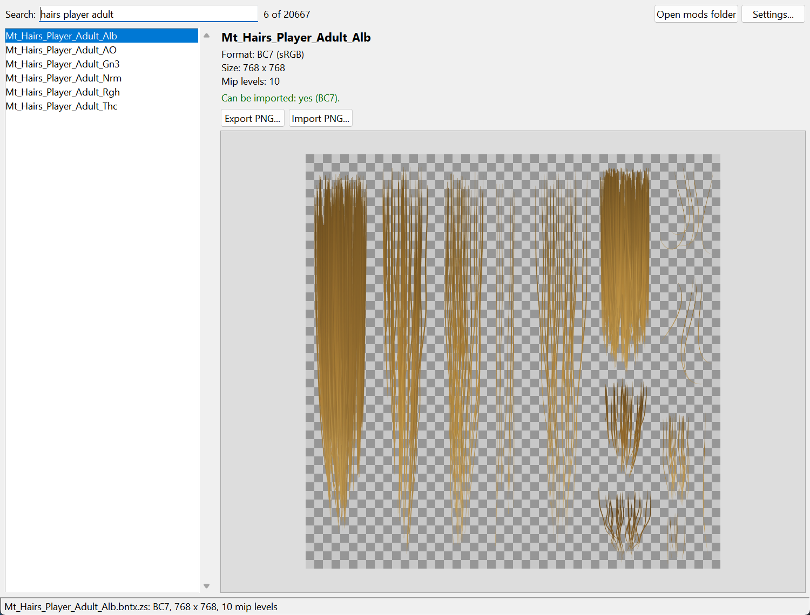
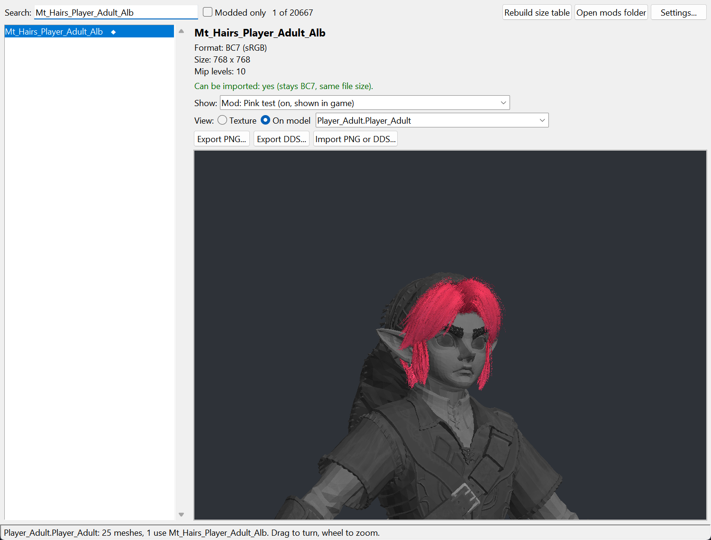
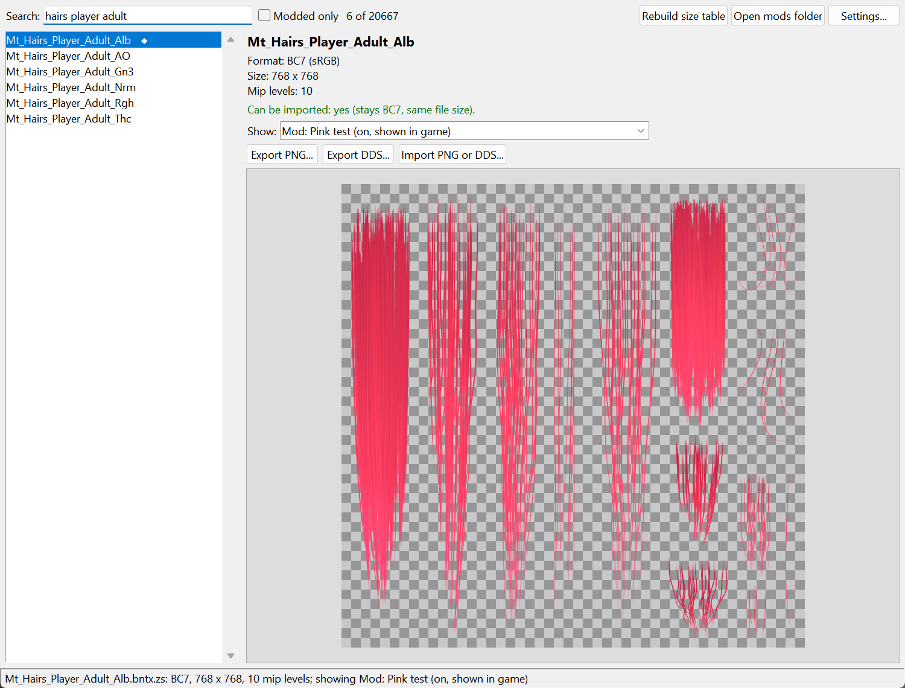
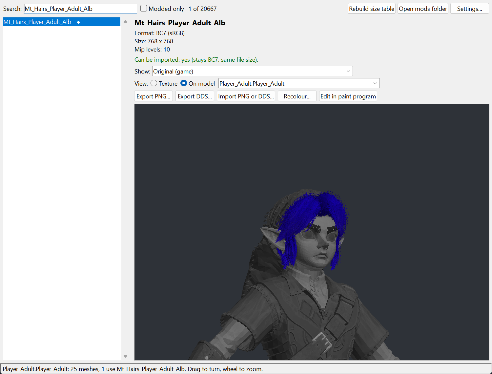
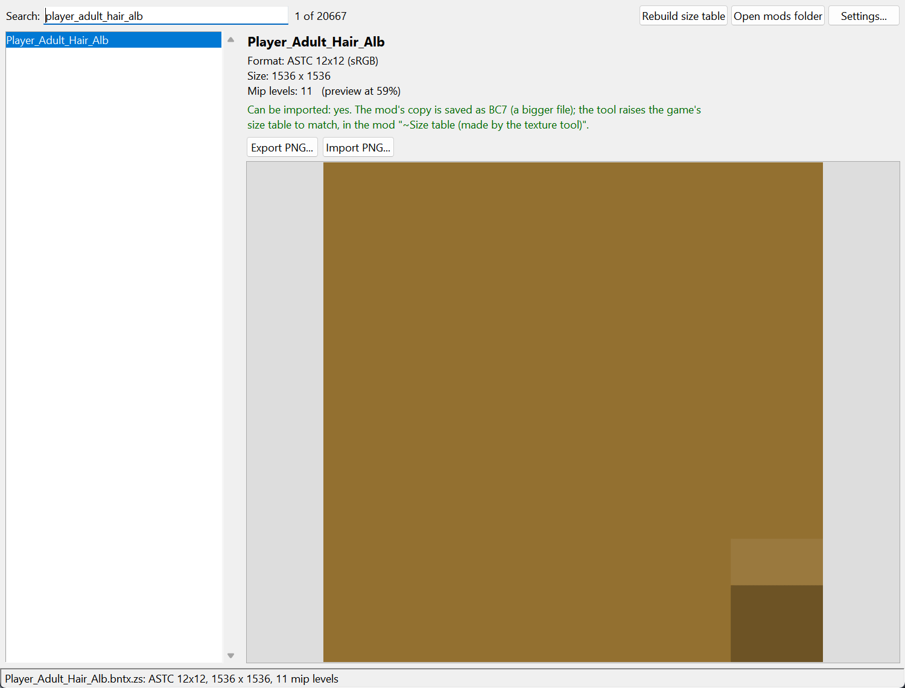

# OOT Texture Tool

**Export and import textures for *The Legend of Zelda: Ocarina of Time* on Switch 2, to make texture mods. Works from a window, with no commands to type.**



- **Find** any of the game's 20,000+ textures by typing part of its name.
- **Preview** the texture, with its format, size, mip levels and whether it can be imported.
- **Export** it as a PNG to edit in any paint program, or as a DDS in its own format.
- **Import** your edited PNG or DDS into a mod folder. Every mip level is rebuilt from your image. BC1, BC3, BC4, BC5, BC7 and ASTC textures can be imported: about 97% of the game's textures.
- **See your mod's version** right away. Textures your mods replace are marked ◆, and **Show** flips between the original and each mod's copy.
- **See it on the model.** **View: On model** draws the texture (or your mod's copy) on the character or object that uses it. Drag to turn it, scroll to zoom.
- **Recolour** with hue, saturation and brightness sliders, watching the result on the model, or **edit in your paint program** and see each save on the model straight away.



The tool only reads the game's files. It writes to your mod folder and nowhere else.

> This repository contains no game files. You need your own dump of the game.

---

## Contents

- [Install](#install)
- [Guide: your first texture mod](#guide-your-first-texture-mod)
- [Settings](#settings)
- [What can be imported](#what-can-be-imported)
- [Command line](#command-line)
- [Troubleshooting](#troubleshooting)
- [Building texconv.exe yourself](#building-texconvexe-yourself)
- [How it works](#how-it-works)
- [Credits and licence](#credits-and-licence)

---

## Install

You need Windows 10 or 11 (64-bit).

### 1. Install Python 3.12 and Pillow

The window runs on Python 3.12. Get it from [python.org](https://www.python.org/downloads/), and tick **"Add python.exe to PATH"** and **"py launcher"** during setup.

Then open a Command Prompt and install Pillow (the image library) and numpy (for the model view):

```bat
py -3.12 -m pip install pillow numpy
```

### 2. Install Python 3.14 or later

The game's files are zstd-compressed. Only Python 3.14 and newer can unpack them without extra packages. Install it from [python.org](https://www.python.org/downloads/) as well; both versions can sit side by side.

The tool runs it as `py -3.15` by default. If you installed a different version, change the command in **Settings** (for example `py -3.14`).

### 3. Get the tool

Download this repository: click **Code > Download ZIP** at the top of the page and unzip it. Or clone it:

```bat
git clone https://github.com/ToxicToucan/oot-texture-tool.git
```

### 4. Add texconv.exe

`texconv.exe` is the small helper that encodes and decodes the texture formats.

1. Download `texconv-windows-x64.zip` from the [Releases](https://github.com/ToxicToucan/oot-texture-tool/releases) page.
2. Unzip it into the tool's folder, next to `texture_tool.py`.

It needs the Microsoft Visual C++ Redistributable (x64). Most PCs have it already; if not, get it from [Microsoft](https://learn.microsoft.com/cpp/windows/latest-supported-vc-redist).

Prefer to build it yourself? See [Building texconv.exe yourself](#building-texconvexe-yourself).

### 5. Start it

Double-click **`Texture Tool.cmd`**.

The first time, open **Settings...** and point it at your game's `romfs` folder and your mods folder. The window checks everything when it starts and tells you if something is missing.

---

## Guide: your first texture mod

As an example, this guide recolours adult Link's hair.

1. **Find the texture.** Type `hairs adult` in the search box. Words can be in any order. Click `Mt_Hairs_Player_Adult_Alb`.
2. **Check it.** The panel shows `Format: BC7`, the size (768 x 768) and **"Can be imported: yes"**.
3. **Export.** Click **Export PNG...** and save it somewhere handy, such as your Desktop.
4. **Edit.** Open the PNG in your paint program (GIMP, Paint.NET, Photoshop, Krita...) and make your changes.
   - **Keep the same width and height.**
   - **Keep the transparency.** See-through areas (the checkerboard in the preview) matter.
   - Save as PNG.
5. **Import.** Back in the tool, with the same texture selected, click **Import PNG or DDS...**.
   1. Pick your edited PNG.
   2. Choose a mod, or choose **New mod...** and type a name such as `Pink hair`.
   3. Wait a few seconds while it encodes every mip level.
   4. The preview now shows your version. Use **Show** to compare it with the original.



   5. To see it on Link, pick **View: On model**. The model list shows every model that uses the texture, with the likeliest first (`Player_Adult` here).
      - The meshes that use your texture are drawn in colour; the rest of the model is dimmed.
      - Drag to turn it and scroll to zoom.
      - The first time, the tool builds its list of models and textures, which takes about 30 seconds.
6. **Turn it on.** Open the game's **Mods** tab, turn your mod on, then restart the game.
   - If the tool made the **`~Size table (made by the texture tool)`** mod (see [ASTC textures and the size table](#astc-textures-and-the-size-table)), turn that on too, and keep it last.

Your mod is a normal folder you can zip and share:

```
mods\
  Pink hair\
    romfs\
      Tex\
        Mt_Hairs_Player_Adult_Alb.bntx.zs
```

**Open mods folder** (top right of the window) opens it in Explorer.

If your mod includes an ASTC texture, also share the `~Size table (made by the texture tool)` folder, or tell people to click **Rebuild size table** after installing it.

### Quicker ways to edit

- **Recolour...** opens hue, saturation and brightness sliders. The preview (texture or model) updates as you move them.
  - **Import into mod...** puts the result in a mod; **Save PNG...** keeps it as a file.
  - It suits colour changes like hair, tunics and gems.
- **Edit in paint program** opens the texture in your default image editor. Each time you save there, the tool's preview (texture or model) updates within a second. When you're happy, click **Import edited file**.
- **Remove from mod** (when **Show** is on a mod's copy) deletes that mod's copy of the texture, after asking. The game's own texture is never touched.
- **Export its textures...** (in the model view) saves every texture of the shown model as PNGs, for repainting a whole character.



### Texture name tips

| Ending | What it is |
| --- | --- |
| `_Alb` | Albedo: the colour you see. This is usually the one to edit. |
| `_Nrm` | Normal map (bumps). Looks purple and blue; edit with care. |
| `_AO`, `_Rgh`, `_Mtl`, `_Thc` | Shading data (shadowing, roughness and so on), not colour. |
| `_Gn0`, `_Gn3` ... | Gradient and mask data. |

`Player_Child_` and `Player_Adult_` are young and adult Link.

---

## Settings

| Setting | What it is | Default |
| --- | --- | --- |
| Game romfs folder | The game's `romfs` folder. It must contain `Tex\` and `Pack\ZsDic.pack.zs`. Only read. | `C:\Switch2\oot-recomp-probe\romfs` |
| Mods folder | Where mods are written. | `C:\Switch2\oot-recomp-probe\merged\mods` |
| Folder with texconv.exe | Where `texconv.exe` and its DLLs are. | The tool's own folder |
| Python 3.14+ command | Runs the zstd step. | `py -3.15` |

The settings are saved in `%LOCALAPPDATA%\oot-texture-gui.json`.

**To experiment safely,** point **Mods folder** at an empty test folder. You can also start the tool with a test folder for one run only:

```bat
pyw -3.12 texture_gui.pyw --mods "C:\some\test\folder"
```

The tool refuses any mods folder that overlaps the game's romfs, `merged\bin` or `merged\work`.

---

## What can be imported

| Format | Export | Import |
| --- | --- | --- |
| BC1, BC3, BC7 (colour) | Yes | **Yes**, same format and file size |
| BC4 (one channel), BC5 (two channels) | Yes | **Yes**, same format and file size |
| ASTC (all block sizes) | Yes | **Yes**, saved as BC7 (see below) |
| BC2, BC6H (HDR lighting) | Yes | No |

The panel tells you which applies when you pick a texture. In a sample of every 20th texture, ASTC was 54%, BC4 35%, and BC1, BC5 and BC7 about 4% each. BC6H was 3% and BC3 under 1%.

- **BC1:** cut-outs (leaves, flowers, fences) keep their transparency. Pixels under half alpha become fully transparent.
- **BC4** holds one channel, often grey data maps (`_AO`, `_Rgh`, `_Trs`). The tool uses the grey value of your image.
- **BC5** holds two channels (red and green), often normal maps.
- **Signed (SNORM) BC4/BC5** are shown shifted by 128: 0 means -1, 128 means 0 and 255 means +1. Import undoes the shift.

**DDS files:** **Export DDS...** saves BC1 to BC7 textures in their own format with every mip level, for paint programs that edit DDS (for example Paint.NET, or Photoshop with the Intel plugin). A DDS you import must be in the texture's format and size. Its blocks are used exactly as they are, mip levels included, and any missing levels are made from the first one.

Quality: exporting, importing unchanged and exporting again changes the image by an amount you can't see:

| Format | Texture | PSNR |
| --- | --- | --- |
| BC1 | `Cloth_LonLon_FlagFence_B_01_Alb` (cut-outs) | 64.0 dB |
| BC3 | `Cloth_Zora_Carpet_C_Alb` | 45.5 dB |
| BC4 | `Bomb_Leaf_Trs` | 50.2 dB |
| BC5 | `Grain_Rock_00_Nrm` | 60.0 dB |
| BC5 SNORM | `Smoke_Thin_DryIce_01_Dst` | 90.6 dB |
| BC7 | `Mt_Hairs_Player_Adult_Alb` | 56.7 dB |
| ASTC to BC7 | `Player_Adult_Hair_Alb` | 82.0 dB |

A DDS exported and imported again gives identical data for every BC format.

### ASTC textures and the size table

The game stores many textures as ASTC, adult Link's hair (`Player_Adult_Hair_Alb`) for example. The tool can't write ASTC, so the mod's copy is rebuilt as BC7. It looks the same, but the file is bigger.

The game keeps a **resource size table** listing how much memory each file needs, and a bigger texture needs a bigger entry. So after every import the tool also writes a copy of that table, with every entry your mods need raised, as its own mod:

```
mods\
  ~Size table (made by the texture tool)\
    romfs\System\Resource\ResourceSizeTable....rsizetable.zs
```

- **Keep it on, and last in the load order.** Its name starts with `~` so it sorts last.
- It covers **all** the mods in the folder, not just the last one you imported.
- It isn't shown in the import list, and nothing else can be imported into it.
- If you delete a mod or copy one in by hand, click **Rebuild size table** (top right). If no mod needs a bigger entry, the table is removed.
- BC1, BC3, BC4, BC5 and BC7 imports never need it. The game's own size table is never changed.



ASTC import is new, so check your texture in game.

---

## Command line

The window drives `texture_tool.py`, which you can also run directly:

```bat
py -3.12 texture_tool.py export <romfs>\Tex\Player_Child_Face_Alb.bntx.zs face.png
py -3.12 texture_tool.py export-dds <romfs>\Tex\Bomb_Leaf_Trs.bntx.zs leaf.dds
py -3.12 texture_tool.py import <romfs>\Tex\Player_Child_Face_Alb.bntx.zs face.png "<mods>\My face mod"
py -3.12 texture_tool.py sizes <mods>
```

`import` takes a PNG or a DDS. `sizes` rebuilds the size table mod, the same as the **Rebuild size table** button.

Environment variables: `TEXCONV_DIR` (folder with `texconv.exe`), `PY_ZSTD` (the Python 3.14+ command), and `OOT_ROMFS` (the game romfs, if the texture is not inside one).

---

## Troubleshooting

| Message | Fix |
| --- | --- |
| *texconv.exe was not found* | Put `texconv.exe` and its three `astcdec-*.dll` files next to `texture_tool.py`, or set the folder in Settings. |
| *"py -3.15" did not run Python 3.14+* | Install Python 3.14 or later, or change the command in Settings to the version you have. |
| *The game textures folder was not found* | Set **Game romfs folder** to the folder that contains `Tex` and `Pack`. |
| *Wrong PNG size* | Resize the PNG to exactly the size shown in the panel. Editing the exported PNG keeps it right. |
| *cannot be imported* | The texture is BC2 or BC6H. See [What can be imported](#what-can-be-imported). |
| *No model uses this texture directly* | Some textures are only used by effects, the menus or the map. Use the Texture view. |
| *keeps its meshes in a form this preview cannot read yet* | Terrain and some map pieces store their meshes differently. Pick another model from the list. |
| *The model view needs numpy* | Run `py -3.12 -m pip install numpy`. |
| *Wrong DDS format* | Save the DDS in the format the panel shows (the mod's copy of an ASTC texture is BC7), or import a PNG instead. |
| *unknown command encode-bc1* or similar | Your `texconv.exe` is from v0.1 or v0.2. Get `texconv-windows-x64.zip` from the latest release. |
| *Pillow missing* | Run `py -3.12 -m pip install pillow`. |
| Nothing happens on double-click | Make sure Python 3.12 is installed with the py launcher, then try `py -3.12 texture_gui.pyw` in a Command Prompt to see the error. |
| My change doesn't show in game | Turn the mod on in the **Mods** tab and restart the game. A mod later in the load order wins if two change the same file. |
| The game crashes or the texture is missing after an ASTC import | Make sure `~Size table (made by the texture tool)` is on and last, then click **Rebuild size table**. |

---

## Building texconv.exe yourself

You need Visual Studio 2022 or later with the C++ tools, [LLVM](https://github.com/llvm/llvm-project/releases) (`clang-cl`), CMake, Ninja and PowerShell 7.

```bat
powershell -File textures\scripts\fetch_third_party.ps1
pwsh -File textures\scripts\build.ps1
build-texconv.cmd
```

1. The first command fetches the pinned versions of astc-encoder, bc7enc_rdo and ISPC into `textures\third_party`. The exact versions are listed in [textures/THIRD_PARTY.md](textures/THIRD_PARTY.md).
2. The second builds the `astc2bc7` library into `textures\build\release`.
3. The third builds `texconv.exe` next to the tool and copies the DLLs it needs. It also compiles `rgbcx.cpp`, bc7enc_rdo's BC1 to BC5 codec, from `textures\third_party\bc7enc_rdo`.

If LLVM is not in `C:\Program Files\LLVM`, run `set LLVM_DIR=<your LLVM folder>` first. To use a bc7enc_rdo copy kept elsewhere, set `RGBCX_DIR`.

---

## How it works

- The game's textures are `.bntx.zs` files: Nintendo BNTX texture containers, zstd-compressed with dictionaries stored in the game's own `Pack\ZsDic.pack.zs`. `zs_helper.py` handles that step on Python 3.14+.
- Texture data on the console is stored in GPU "block-linear" order: GOBs of 64 bytes by 8 rows, stacked in blocks. The order of bytes *inside* a GOB on Switch 2 differs from the original Switch. It was found by testing all orders against the game's own textures; see `swizzle_offsets` in `texture_tool.py`.
- `texconv.exe` decodes ASTC (ARM astcenc), encodes BC7 (Binomial bc7e), and encodes BC1, BC3, BC4 and BC5 (rgbcx). BC1 blocks with transparent pixels use BC1's 3-colour mode, where the fourth index is transparent.
- On import, every mip level is downscaled from your PNG, encoded in the texture's format, put back into block-linear order, and recompressed with the same dictionary. BC textures keep their exact size.
- Signed BC4/BC5 blocks become unsigned by flipping the top bit of their two endpoint bytes. That keeps the block's mode and steps, so the round trip is exact.
- An ASTC texture's container is laid out again for BC7: new mip offsets, then the data block, relocation table and header pointers are moved. The resource size table (CRC32 of each file's path, mapped to the size it needs: unpacked size + 280 for textures) is merged for every mod into the size table mod.

**The model view:**
- `model_index.py` (Python 3.14+) reads each of the game's 6,409 models (`Model\*.bfres.zs`) once. It records which textures each model names, and caches the list in `%LOCALAPPDATA%\oot-texture-gui\model_index.json`.
- `bfres_model.py` reads a model (BFRES version 10, the same as *Tears of the Kingdom*): each shape's full-detail mesh, its material's texture names, and the skeleton, which places rigid parts like the eyes.
- It draws the model with a small software renderer in numpy (a z-buffer, with cut-outs for materials like hair and fur) at a fraction of a second per frame. Skinned meshes are drawn in their rest pose.
- Numbered textures (`…_Alb.0` to `…_Alb.13`) are variants the game swaps into the `.0` slot, so any of them shows in that slot.

| File | Purpose |
| --- | --- |
| `Texture Tool.cmd` | Double-click launcher |
| `texture_gui.pyw` | The window (Tkinter) |
| `texture_tool.py` | Export and import; also a command-line tool |
| `zs_helper.py` | zstd with the game's dictionaries |
| `bfres_model.py` | Reads models and draws them for the model view |
| `model_index.py` | Lists which models use which textures (Python 3.14+) |
| `texconv.cpp`, `build-texconv.cmd` | The codec helper (ASTC decode; BC1, BC3, BC4, BC5, BC7 encode) and its build script |
| `textures/` | The `astc2bc7` library that `texconv` links (ASTC decode, BC7 encode) |

---

## Credits and licence

- This tool is licensed under the **GNU GPL v3.0 or later**; see [LICENSE](LICENSE).
- [ARM astc-encoder](https://github.com/ARM-software/astc-encoder) (Apache-2.0) decodes ASTC.
- [bc7enc_rdo](https://github.com/richgel999/bc7enc_rdo) by Richard Geldreich, Jr. and Binomial LLC: bc7e (Apache-2.0) encodes BC7, and rgbcx (MIT or public domain) encodes BC1 to BC5.
- [Intel ISPC](https://github.com/ispc/ispc) (BSD-3-Clause) compiles bc7e.
- The BNTX and BFRES field layouts follow the notes in [Switch-Toolbox](https://github.com/KillzXGaming/Switch-Toolbox) and BfresLibrary, checked against this game's files.

The licence texts for the third-party parts are in [textures/licenses](textures/licenses).

*Not affiliated with or endorsed by Nintendo. The Legend of Zelda and Ocarina of Time are trademarks of Nintendo. This repository contains no game code or assets; use it only with a game you own.*
